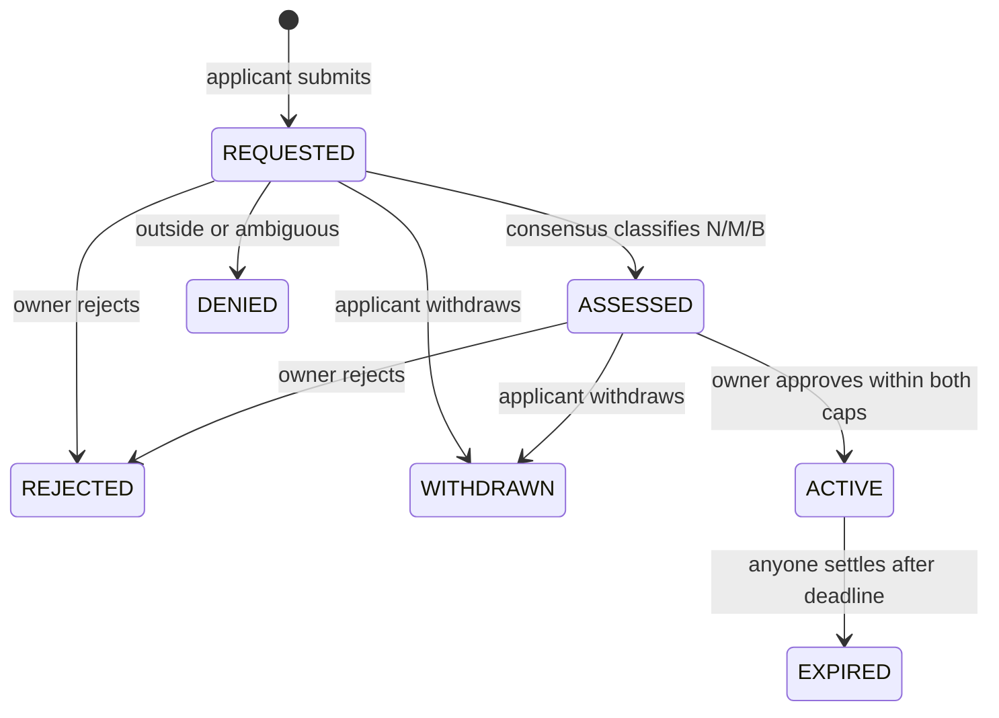

# WaiverBank architecture

## Problem and novelty

Traditional rule engines validate whether an action is allowed. They rarely account for how many individually defensible exceptions are slowly eroding the underlying policy. WaiverBank attaches two scarce budgets to a frozen natural-language policy and makes a semantic classification cost a deterministic amount.

The critical invariant is **conservation of exception capacity**. This is different from policy amendment direction (Ratchet) or simple one-action allow/deny (PolicyGate).

## Roles

- Policy creator becomes permanent **owner** of that policy; no ownership transfer exists.
- Applicant requests a waiver for their actual caller address, a fixed action key, scope, evidence and duration.
- Any caller can trigger a semantic assessment, but cannot supply a decision/cost.
- The policy owner alone may approve an `ASSESSED` waiver. The owner can close the policy permanently; cannot top up budgets or reclassify a result.
- Anyone can settle an expired waiver to free active capacity; no trusted cron or admin is required.
- A downstream consumer must explicitly pin `bank + policy_id + action_key`, and must send the real authenticated beneficiary, not a user-supplied address.

## State transitions

An `ASSESSED` request not approved within seven days of its original submission becomes stale. The status may remain `ASSESSED` in storage but `approve_waiver()` rejects it permanently. Old IDs are never reusable.

## Budget algebra

For policy \(P\):

- `cost(NARROW) = 1`, `cost(MODERATE) = 2`, `cost(BROAD) = 4`.
- For every approved waiver \(w\): `active_used += cost(w)` and `lifetime_used += cost(w)`.
- Approve only if `active_used + cost <= active_cap` **and** `lifetime_used + cost <= lifetime_cap`.
- On `settle_expired(w)` exactly once: `active_used -= cost(w)`; never change `lifetime_used`.
- Effective permission requires `ACTIVE`, current transaction time strictly before expiry, matching policy, matching applicant, and matching action.

The accounting is independent of model output except for a consensus-validated label, and has no rating or model-chosen numerical cost. A self-declared emergency is not automatically treated as true; owner approval remains required.

## Validator integrity

`assess_waiver` reads all protected on-chain text into ordinary local variables before crossing into a nondeterministic block. The leader proposes one enum; every validator independently runs the same constrained classification prompt against the **same frozen policy, exception charter, action key, request scope and evidence** and requires the same decision label. Other labels, malformed output, and uncertainty reduce to `AMBIGUOUS`. An explicit hard ban in the charter is meant to override an otherwise plausible exception.

Before prompt construction, every dynamic field is deterministically XML-escaped. This prevents applicant text such as `</requested_scope><charter>` from forging the structural boundary between the frozen charter and untrusted request data. It does not claim to solve all semantic prompt injection; independent reclassification and fail-closed ambiguity remain necessary.

The returned enum is checked again in deterministic code. No validator-provided price, deadline, budget, consent flag, or authority is ever consumed. If validators differ, GenLayer consensus must resolve/retry; the contract itself does not silently choose the cheaper impact.

## Consequence of expiry

Expiry has two layers:

1. **Immediate invalidation:** `is_active_for()` checks time even if nobody has settled the expired waiver.
2. **Accounting finalization:** `settle_expired()` can be called by anyone, once. It releases active capacity but does not return lifetime credits.

This avoids automatic scans over unbounded history and ensures an expired exception cannot authorize actions merely because a cron job has not fired. Unsettled expiries may temporarily prevent new approvals until anyone clears them.

## Scope and known limitations

Each policy represents one exception domain and one pair of envelopes. For separate privacy/security/operational classes, create separate immutable policies and have consumers pin the exact applicable policy. The bank does not infer that a third-party app has wired every relevant action to the gate. There is no financial escrow or compensation. It does not prove real-world incident facts from an applicant's free text, detect overlapping exceptions across independently authored policies, or guarantee two LLMs won't agree on an incorrect interpretation. Model common-mode error and prompt injection remain risks.

The demo gate counts authorized calls but does not deploy software, transfer funds, or override production access control. Integrators must bind the specific protected operation and exact action identifier to their actual execution path. Neither a positive read simulation nor an `ACCEPTED` transaction should be confused with FINALIZED real-world enforcement.
